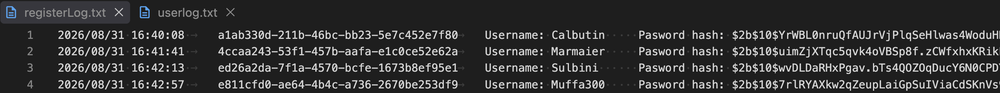
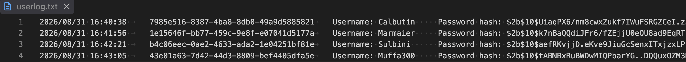
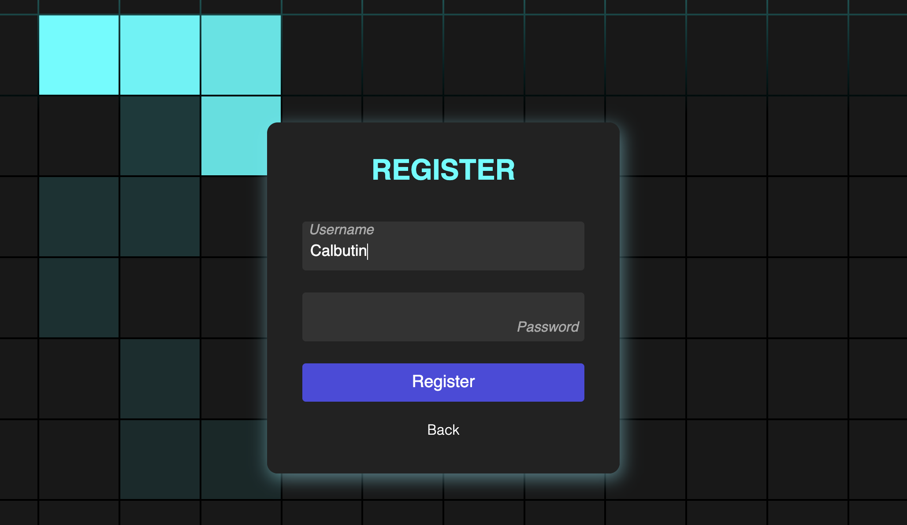

# User Log 

An Express.js application that serves as a user authentication and request logging demo with static HTML pages beautifully crafted UIs.






## Overview

This project serves as Node.js web app for experimenting with:

- Express route handling
- static page serving
- form-based login and registration flows
- password hashing with bcrypt
- request logging for submitted user data
- basic 404/error handling

The application is intentionally kept simple and is best thought of as a demo or starter project rather than a production-ready auth system. User data from authentication and authorization are logged to a respective file in a `logs` directory which is created for the first registration/login.
`
## Features

- Home, About, Contact, Login, and Register views
- Express app serving static assets from the public folder
- Login and registration POST routes
- Password hashing before logging authentication data
- Timestamped log entries saved under the logs directory
- 404 page for missing routes
- Optional custom port via `PORT_ASSIGNMENT`

## Tech stack

- Node.js
- Express
- bcryptjs
- dotenv

## Project layout

```text
.
├── middleware/
│   ├── entryLog.js
│   └── errorHandler.js
├── public/
│   ├── inside.css
│   ├── login.css
│   ├── register.css
│   └── style.css
├── routes/
│   └── route.js
├── views/
│   ├── 404.html
│   ├── about.html
│   ├── contact.html
│   ├── index.html
│   ├── inside.html
│   ├── login.html
│   └── register.html
├── .gitignore
├── LICENSE
├── package.json
├── package-lock.json
├── server.js
└── README.md
```

## Getting started

1. Install dependencies:

   ```bash
   npm install
   ```

2. Create certificates for https:

   ```bash
   mkcert -key-file certificates/localhost-key.pem -cert-file certificates/localhost.pem localhost 127.0.0.1 ::1
   ```

3. Run the app in a browser:

   ```bash
   npm run dev
   ```

## Environment variables

The app reads an optional environment variable for the server port:

If `PORT` is not set, the app defaults to port `3232`.

## Notes

- This application is meant for a demo and not a auth system. 
- It serves static HTML pages and bcrypt-hashes the passwords and appends them to a file under logs.
- Any non-empty username and password “succeeds.” 
- It is not meant to be used as a production authentication system and should not be treated as secure storage.

## License

This project is licensed under the MIT License.
